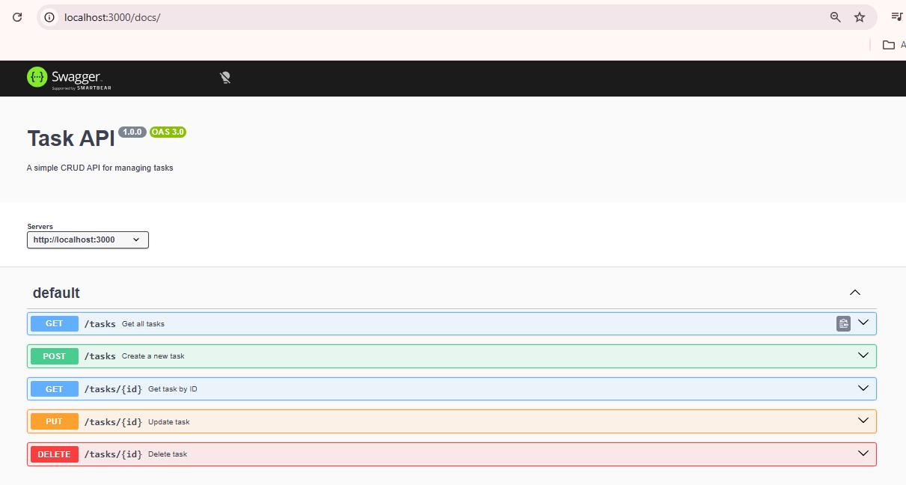

# Task API

A simple CRUD API built using Node.js and Express.js as part of the FlyRank Backend Internship - Week 2 Assignment.

## About the Project

Task API is a REST API that allows users to create, read, update and delete tasks.

Each task contains:
- id: Unique task ID
- title: Task name
- done: Task completion status

Tasks are stored in memory using a JavaScript array.

## Technologies Used

- Node.js
- Express.js
- JavaScript
- Swagger UI
- Git and GitHub

## Installation

1. Clone the repository:

   git clone https://github.com/sanjanarajpal/task-api.git

2. Navigate to the project folder:

   cd task-api

3. Install dependencies:

   npm install

4. Start the server:

   node server.js

The API runs at:

http://localhost:3000

## API Endpoints

| Method | Endpoint | Description |
|--------|----------|-------------|
| GET | / | Get API information |
| GET | /health | Check server status |
| GET | /tasks | Get all tasks |
| GET | /tasks/:id | Get a task by ID |
| POST | /tasks | Create a new task |
| PUT | /tasks/:id | Update a task |
| DELETE | /tasks/:id | Delete a task |

## Swagger Documentation

Interactive API documentation is available at:

http://localhost:3000/docs

Swagger UI allows users to test all CRUD operations using the Try it out feature.

## Example Request

POST /tasks

Request body:

{
  "title": "Learn JavaScript"
}

Example response:

{
  "id": 4,
  "title": "Learn JavaScript",
  "done": false
}

## Status Codes

- 200: Successful request
- 201: Task created
- 204: Task deleted
- 400: Invalid request
- 404: Task not found

## Note

This project uses in-memory storage. Tasks are reset when the server restarts.

## Author

Sanjana Rajpal

## Swagger UI Screenshot

